# 🏙️ Smart City Cluj-Napoca — IoT, AI & Urban Intelligence Platform

[](https://streamlit.io/)


---

### 🌐 Live Production Access (Recruiter & Auditor Invitation)

Dacă sunteți Recrutor, Manager Tehnic sau Auditor de Sistem, nu este necesar să clonați depozitul sau să configurați Python local pentru a evalua această platformă.

Puteți accesa instantaneu mediul cloud live, complet securizat pentru producție: 👉 **[Launch Smart City Cluj-Napoca Live Dashboard](https://cluj-smartcity-iot-platform-secure-sha256-app-and-app-json-met.streamlit.app/)**

* **Authorized Username:** `admin`
* **Plaintext Access Key:** `cluj2026`

> **Security Note:** Stratul de autentificare convertește dinamic introducerea în text simplu într-o **semnătură criptografică SHA-256** la rulare și o verifică în raport cu seiful securizat izolat din cloud, folosind validarea în timp constant `hmac.compare_digest()`. Datele de autentificare codificate rigid (hardcoded) sau șirurile de parole brute sunt strict excluse din baza de cod, respectând în totalitate standardele de conformitate OWASP Top 10.

---

O aplicație Python modulară pentru monitorizarea telemetriei urbane, analiză de date, modelare statistică, recomandări operaționale asistate de IA, alerte configurabile, auditare de securitate și export de date structurate.

Proiectul demonstrează un flux de lucru complet de inginerie software care combină persistența relațională locală, vizualizarea interactivă, tehnici clasice de învățare automată (Machine Learning) și integrarea modelelor de limbaj mari (LLM).

> **Proiect tip:** Portofoliu de inginerie și demonstrație aplicată de AI/ML
> **Limbaj principal:** Python 3.12
> **Interfață:** Streamlit
> **Bază de date:** SQLite
> **Inferență AI:** Groq Cloud API cu `openai/gpt-oss-20b`

## Table of Contents

- [Project Overview](#project-overview)
- [Visual Showcase](#visual-showcase)
- [Core Features](#core-features)
- [Application Architecture](#application-architecture)
- [Technology Stack](#technology-stack)
- [Security and Authentication](#security-and-authentication)
- [AI and LLM Integration](#ai-and-llm-integration)
- [Analytics and Machine Learning](#analytics-and-machine-learning)
- [Automated Testing](#automated-testing)
- [Installation and Execution](#installation-and-execution)
- [Project Structure](#project-structure)
- [Limitations and Disclaimer](#limitations-and-disclaimer)

---

## Project Overview

Smart City Cluj-Napoca este o platformă locală de monitorizare urbană concepută pentru a colecta, persista, analiza, vizualiza și interpreta telemetria asociată cu mai multe locații de monitorizare.

Aplicația funcționează fără a necesita o rețea fizică de senzori IoT sau o infrastructură municipală externă. Aceasta suportă telemetrie persistată local și date sintetice în scopuri demonstrative și analitice.

### Monitored Parameters

Platforma funcționează cu cinci dimensiuni de telemetrie:

| Parametru | Descriere |
|---|---|
| Temperatură | Măsurători ale temperaturii ambientale |
| Nivel de Zgomot | Măsurători ale zgomotului în decibeli |
| Flux de Trafic | Încărcarea traficului reprezentată ca procent |
| Calitatea Aerului | Măsurători ale calității aerului, inclusiv scenarii legate de PM2.5 |
| Umiditatea Solului | Măsurători ale umidității solului reprezentate ca procent |

Fiecare nod de monitorizare poate fi asociat cu un identificator de senzor, coordonate geografice, măsurători istorice și praguri operaționale configurabile.

### End-to-End Workflow

```text
Telemetry Collection
        |
        v
SQLite Persistence
        |
        v
Data Validation and Threshold Evaluation
        |
        v
Analytics and Statistical Modeling
        |
        v
AI Context Construction
        |
        v
LLM Inference and Response Sanitization
        |
        v
Operational Recommendations
        |
        v
Alert Logging, Visualization and Data Export
```

Aplicația combină procesarea deterministă în Python cu recomandările generate de IA. Aceste componente au responsabilități diferite: codul convențional se ocupă de persistență, evaluarea pragurilor și calculele statistice, în timp ce LLM-ul generează rezultate textuale contextuale în limbaj natural.

## Visual Showcase

Următoarele capturi de ecran ilustrează interfața aplicației și capabilitățile sale analitice.

### 1. Authentication and Access

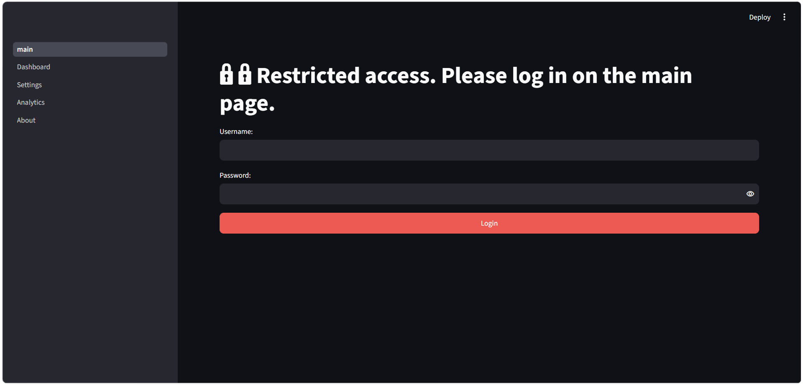

*Interfața de autentificare a operatorului.*

### 2. Operational Dashboard

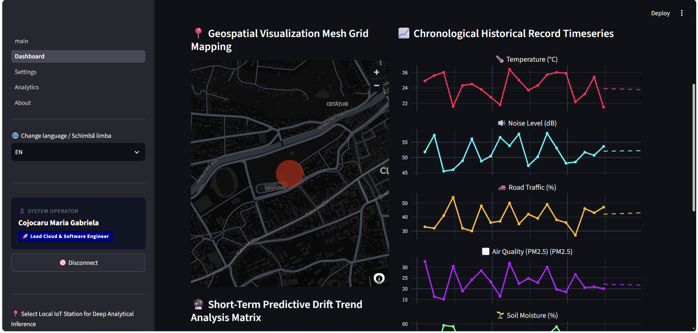

*Panou central pentru monitorizarea telemetriei și indicatori operaționali.*

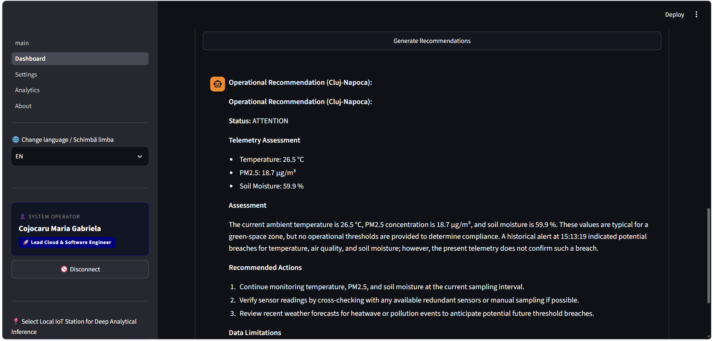

*Recomandări asistate de IA generate pe baza contextului de monitorizare.*

### 3. Analytics and Machine Learning

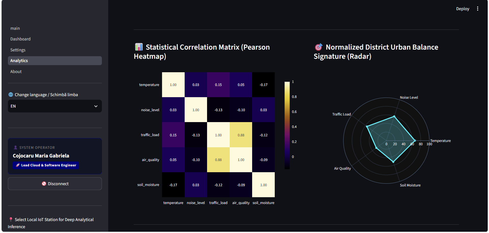

*Analiza corelației între parametrii de telemetrie monitorizați.*

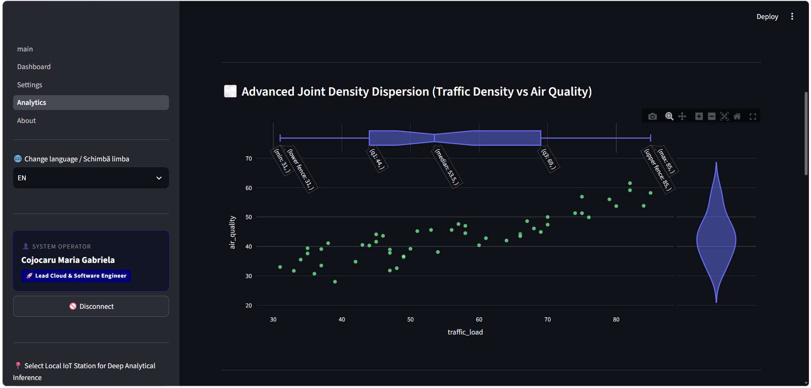

*Vizualizarea regresiei liniare pe baza variabilelor de telemetrie selectate.*

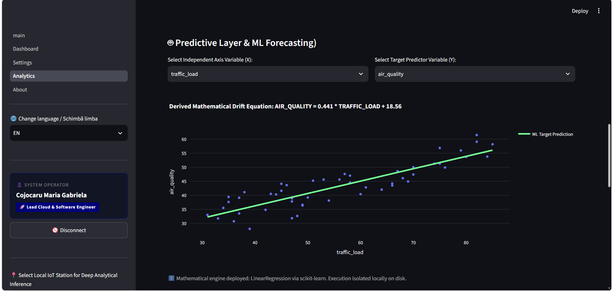

*Ecuația de regresie afișată de interfața analitică.*

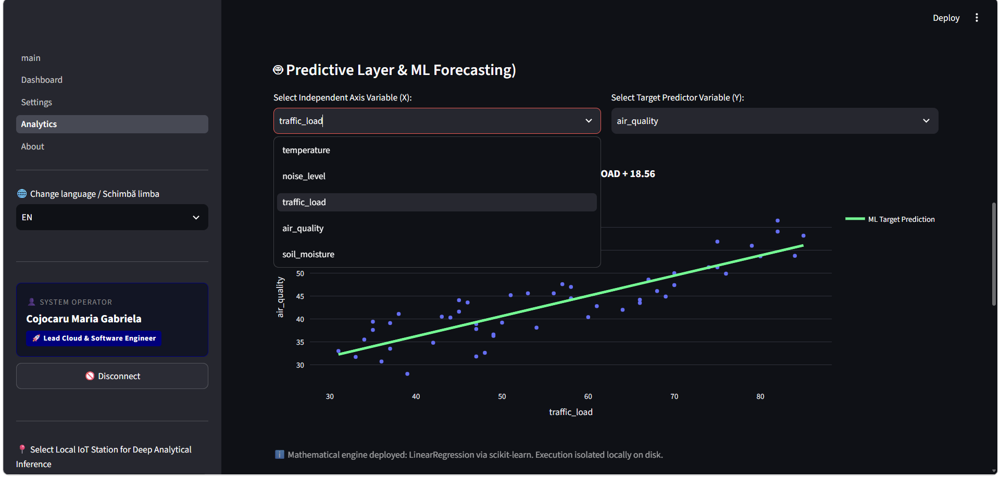

*Selectarea variabilei independente utilizate în analiza de regresie.*

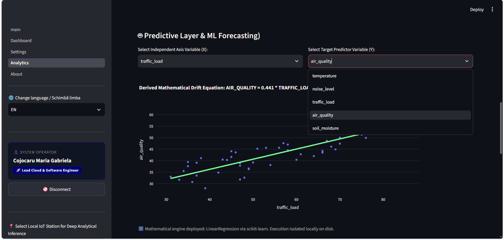

*Selectarea variabilei țintă.*

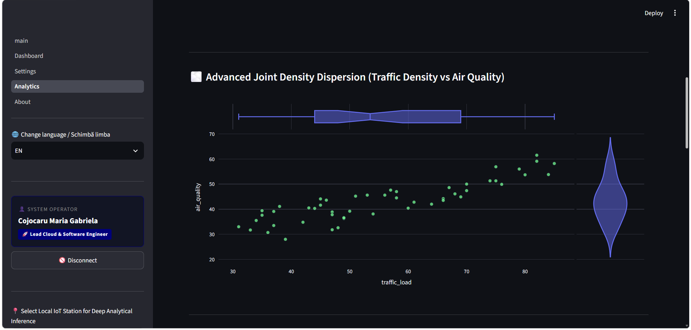

*Vizualizare interactivă a distribuției și a relațiilor dintre date.*

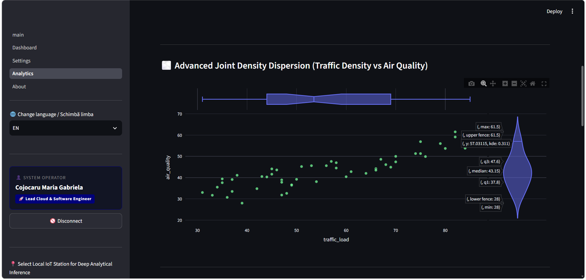

*Analiza distribuției folosind o diagramă de tip violin.*

### 4. Configuration and Data Management

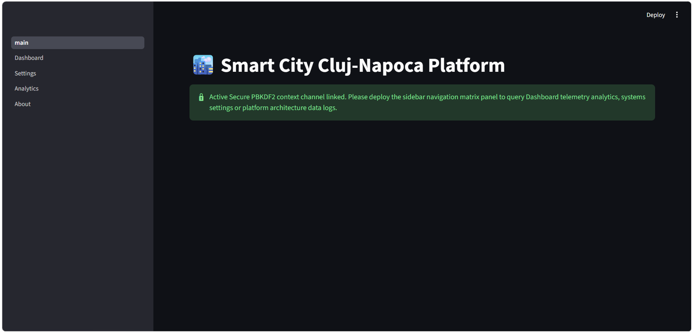

*Controale administrative și praguri configurabile pentru telemetrie.*

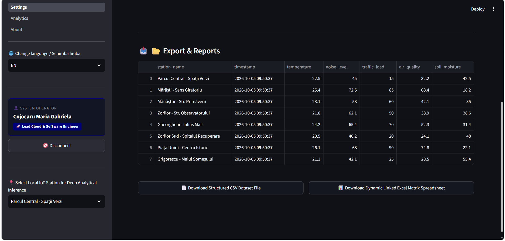

*Interfață pentru exportul seturilor de date de telemetrie.*

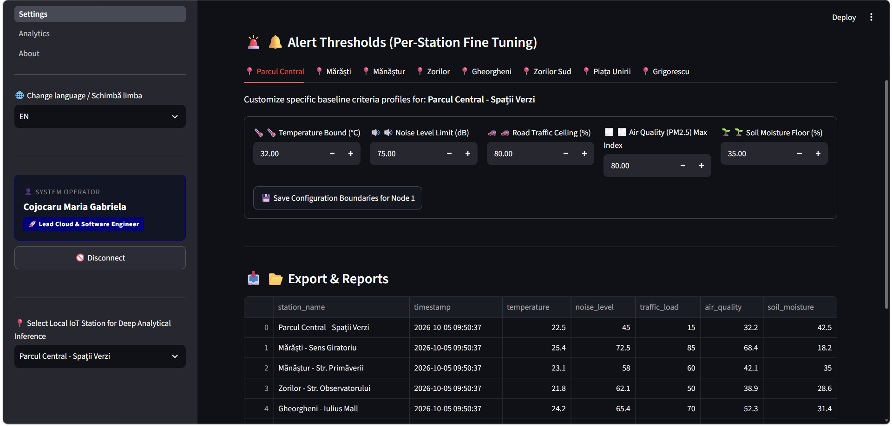

*Prezentarea raportului de telemetrie.*

### 5. Architecture and Localization

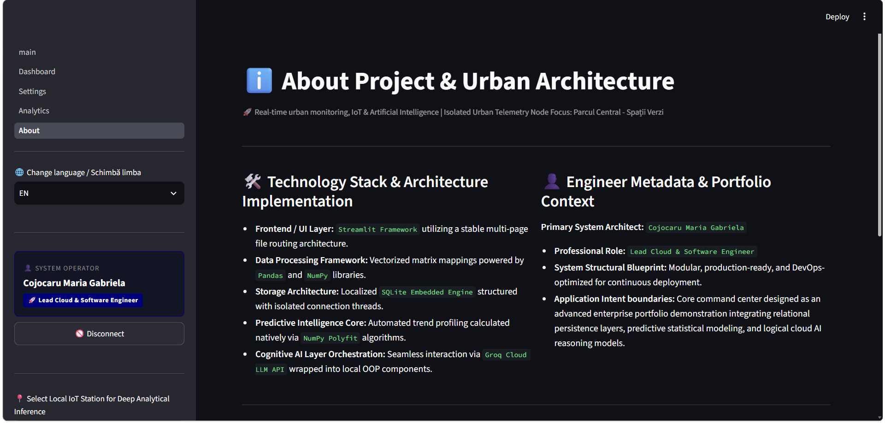

*Prezentare generală a arhitecturii aplicației.*

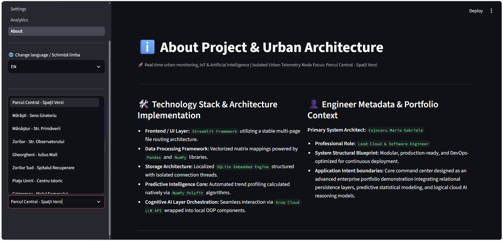

*Selectarea stației de monitorizare.*

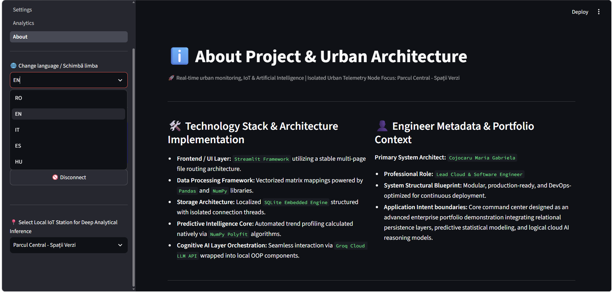

*Selectarea interfeței multilingve.*

## Core Features

### Telemetry and Data Management

- Persistență relațională locală folosind SQLite.
- Noduri de monitorizare cu coordonate geografice.
- Preluarea și vizualizarea istoricului telemetriei.
- Praguri configurabile pentru noduri individuale de monitorizare.
- Soluție de rezervă (fallback) cu telemetrie sintetică pentru scenarii demonstrative.
- Export de date în formate CSV și Excel.

### Analytics and Machine Learning

- Matrice de corelație Pearson.
- Vizualizări statistice interactive.
- Regresie liniară folosind NumPy.
- Variabile independente și țintă selectabile de către utilizator.
- Vizualizarea ecuației de regresie și a valorilor prezise.
- Pregătirea și analiza datelor bazată pe Pandas.

### AI and LLM Integration

- Integrare cu Groq Cloud API.
- Model LLM țintă configurabil.
- Construirea de prompt-uri adaptate la context.
- Recomandări operaționale bazate pe datele de telemetrie.
- Igienizarea (sanitization) răspunsurilor înainte de prezentarea în interfața grafică.
- Evaluări automate ale LLM-ului bazate pe scenarii.
- Scenarii de testare a securității împotriva atacurilor de tip prompt-injection.

### Security and Reliability

- Serviciu dedicat pentru autentificare.
- Verificarea hash-ului parolei.
- Comparare în timp constant utilizând `hmac.compare_digest()`.
- Praguri operaționale configurabile pentru alerte.
- Suprimarea alertelor duplicate printr-un mecanism de răcire (cooldown).
- Jurnalizare locală a auditului de securitate (audit logging).
- Protecție consolidată împotriva atacurilor de tip log-injection.
- Teste de regresie automate și analiză statică.

### User Experience

- Interfață Streamlit multi-pagină.
- Localizare în limbile română, engleză, italiană, spaniolă și maghiară.
- Vizualizări interactive Plotly.
- Vizualizări geografice ale monitorizării.
- Setări administrative și rapoarte descărcabile.

---
## Application Architecture

Aplicația urmează un design modular, orientat pe responsabilități. Interfața cu utilizatorul, autentificarea, persistența, analiza datelor, integrarea IA și sistemul de alerte sunt separate în componente distincte.

```text
Smart City Application
|
+-- main.py
|   +-- Application initialization
|   +-- Environment configuration
|   +-- Authentication gateway
|   +-- Database initialization
|
+-- pages/
|   +-- 1_Dashboard.py
|   +-- 2_Settings.py
|   +-- 3_Analytics.py
|   +-- 4_About.py
|
+-- app/
|   +-- ai/

|   |   +-- ai_interface.py
|   |   +-- groq_provider.py
|   |
|   +-- database/
|
+-- src/
|   +-- utils/
|       +-- local_alerts.py
|
+-- ai_tests/
|   +-- prompts.txt
|   +-- run_llm_eval.py
|
+-- promptfooconfig.yaml
+-- translations.py
+-- seed_db.py
+-- tests/
```

*Diagrama reprezintă principalele zone arhitecturale descrise de documentația proiectului. Depozitul complet poate conține module și fișiere de configurare suplimentare.*

### Architectural Responsibilities

| Componentă | Responsabilitate |
|---|---|
| Streamlit UI | Randează panoul de bord (dashboard), setările, analizele și paginile informative |
| Serviciul de autentificare | Verifică datele de autentificare ale operatorului |
| Baza de date SQLite | Persistă telemetria și configurația aplicației |
| Stratul de analiză (Analytics) | Pregătește datele și calculează rezultatele statistice |
| Managerul de alerte | Aplică perioadele de răcire (cooldown) pentru alerte și scrie evenimentele locale de audit |
| Interfața AI | Construiește contextul și gestionează fluxul de lucru pentru recomandările IA |
| Providerul Groq | Trimite cererile de inferență către endpoint-ul LLM configurat |
| Promptfoo | Execută scenarii declarative de evaluare a LLM-ului |
| Pytest | Rulează testele automate în Python |

Aplicația este concepută ca un proiect de inginerie de nivel de portofoliu. Arhitectura sa demonstrează modul în care procesarea convențională de backend, analiza de date, controalele de securitate și inteligența artificială generativă pot fi integrate într-o singură aplicație locală.

---
## Technology Stack

Proiectul combină dezvoltarea de aplicații Python, persistența datelor relaționale, analiza interactivă a datelor și integrarea inteligenței artificiale generative.

### Core Technologies

| Tehnologie | Scop |
|---|---|
| Python 3.12 | Limbajul principal al aplicației |
| Streamlit | Interfață interactivă multi-pagină pentru utilizator |
| SQLite | Bază de date relațională locală |
| SQLAlchemy | Abstracția bazei de date și suport ORM, acolo unde este utilizat |
| Alembic | Instrument de migrare a bazei de date, acolo unde este configurat |
| Pandas | Pregătirea și analiza datelor tabulare |
| NumPy | Calcule numerice și regresie liniară |
| Plotly | Diagrame interactive și vizualizări statistice |
| Groq SDK | Comunicarea cu API-ul de inferență Groq |
| Promptfoo | Evaluarea LLM și scenarii de testare adversariale |
| Pytest | Testare automată |
| Ruff | Linter Python și verificări ale calității codului |
| uv | Managementul dependențelor și al mediului Python |
| Docker | Suport pentru execuție containerizată |
| GitHub Codespaces | Mediu de dezvoltare bazat în cloud |

Prezența unei dependențe în configurația proiectului nu înseamnă neapărat că fiecare pachet este utilizat de fluxul de lucru activ al aplicației.

### AI and Analytics Technologies

- Inferența modelelor de limbaj mari prin intermediul Groq Cloud API.
- Construirea de prompt-uri adaptate la context.
- Evaluarea LLM bazată pe scenarii.
- Analiza corelației statistice.
- Regresie liniară bazată pe NumPy.
- Vizualizarea interactivă a relațiilor dintre datele de telemetrie.
- Testarea automată a unor comportamente de securitate selectate.

### Development Environment

Proiectul vizează Python 3.12 și utilizează `uv` pentru a gestiona dependențele și a executa comenzile Python.

Depozitul conține, de asemenea, configurații de dezvoltare și automatizare destinate să susțină un flux de lucru local consecvent.

---

## Database and Telemetry Management

### Local Persistence

Aplicația utilizează SQLite pentru persistența locală a datelor.

Baza de date stochează datele de telemetrie și configurație utilizate de interfața operațională. Istoricul documentat al telemetriei este preluat din tabelul `city_stats` și filtrat după identificatorul de senzor selectat.

Fișierul implicit al bazei de date locale este:

```text
app.db
```

Aplicația este concepută să funcționeze fără un server de bază de date extern.

### Telemetry Data Model

Dimensiunile de telemetrie monitorizate sunt:

| Câmp | Descriere |
|---|---|
| `temperature` | Măsurarea temperaturii |
| `noise_level` | Măsurarea nivelului de zgomot |
| `traffic_load` | Măsurarea fluxului de trafic |
| `air_quality` | Măsurarea calității aerului |
| `soil_moisture` | Măsurarea umidității solului |

Înregistrările de monitorizare sunt asociate cu identificatori de senzori și timbre temporale (timestamps). Nodurile de monitorizare pot conține, de asemenea, coordonate geografice și praguri configurabile individual.

### Historical Data Processing

Fluxul de lucru documentat al panoului de bord preia înregistrările recente de telemetrie pentru nodul de monitorizare selectat și transformă rezultatele în DataFrames Pandas.

Fereastra standard pentru istoricul panoului de bord este de 20 de înregistrări recente.

Plotly este utilizat pentru a randa tendințele de telemetrie rezultate.

### Synthetic Data Fallback

Aplicația oferă suport pentru telemetrie sintetică atunci când nu sunt disponibile suficiente înregistrări istorice.

Conform documentației proiectului:

- Panoul de bord (Dashboard) generează un istoric sintetic de 20 de înregistrări atunci când sunt disponibile mai puțin de două înregistrări istorice utilizabile.
- Pagina de analize (Analytics) generează un istoric sintetic mai mare atunci când sunt disponibile mai puțin de cinci înregistrări.

Acest mecanism face aplicația demonstrabilă fără o rețea fizică de senzori sau o bază de date complet populată.

Datele sintetice trebuie distinse de măsurătorile reale ale senzorilor atunci când se interpretează rezultatele analitice.

### Geographic Monitoring

Nodurile de monitorizare conțin valori pentru latitudine și longitudine.

Panoul de bord utilizează aceste coordonate pentru a afișa locația de monitorizare selectată. Acest lucru oferă un context geografic pentru vizualizarea telemetriei fără a necesita un backend extern dedicat pentru hărți.

---

## Authentication and Credential Handling

Aplicația conține un serviciu dedicat `AuthenticationService` responsabil pentru verificarea datelor de autentificare ale operatorului.

Fluxul de lucru documentat pentru autentificare include:

1. Preluarea numelui de utilizator configurat pentru operator.
2. Preluarea hash-ului parolei stocate din configurația mediului.
3. Hash-uirea parolei furnizate înainte de comparare.
4. Compararea valorilor rezultate folosind `hmac.compare_digest()`.
5. Menținerea stării de autentificare a aplicației prin intermediul stării sesiunii Streamlit (session state).

### Environment Configuration

Variabilele de mediu de configurare așteptate sunt:

```env
PLATFORM_ADMIN_USER=your_admin_username
PLATFORM_ADMIN_PASS=your_password_hash
```

Se așteaptă ca `PLATFORM_ADMIN_PASS` să conțină un hash de parolă, nu o parolă în text clar.

Datele de autentificare reale și cheile API nu trebuie niciodată transmise (committed) în depozitul public.

### Security Considerations

Implementarea autentificării separă verificarea datelor de autentificare de stratul de prezentare.

Proiectul documentează, de asemenea, jurnalizarea locală a auditului, controalele perioadei de răcire a alertelor și igienizarea datelor de intrare (input sanitization) menite să reducă riscurile de securitate selectate.

Aceste mecanisme demonstrează un design de aplicație orientat spre securitate, dar ele nu ar trebui interpretate ca o certificare completă de securitate sau ca un substitut pentru o evaluare formală de securitate.

---

## Operational Alerting and Security Auditing

Aplicația conține o componentă locală de gestionare a alertelor:

```text
src/utils/local_alerts.py
```

Clasa centrală este documentată ca fiind:

```python
AlertManager
```

### Alert Management Features

Funcționalitatea documentată include:

- Control configurabil al perioadei de răcire (cooldown).
- Suprimarea alertelor duplicate.
- Jurnalizare locală de audit.
- Igienizarea caracterelor de linie nouă (newline) și retur de car (carriage-return).
- Protecție consolidată împotriva atacurilor de tip log-injection.
- Gestionarea erorilor sistemului de fișiere.
- Output de audit local determinist.

Perioada de răcire implicită documentată este de 10 secunde.

Fișierul local de audit este:

```text
security_alerts.log
```

O intrare de audit urmează o structură similară cu:

```text
[YYYY-MM-DD HH:MM:SS] [ALERT] [ALERT_TYPE] message
```

Mecanismul de cooldown este conceput pentru a preveni ca alertele repetate de același tip să genereze intrări excesive în jurnal în fereastra de timp configurată.

### Configurable Thresholds

Pragurile operaționale implicite documentate sunt:

| Parametru | Prag implicit |
|---|---:|
| Temperatură | 32.0 °C |
| Nivel de zgomot | 75.0 dB |
| Flux de trafic | 80.0% |
| Calitatea aerului | 80.0 |
| Umiditatea solului | 35.0% |

Aceste valori sunt valori implicite ale aplicației, nu standarde ecologice sau de reglementare universale.

Interfața de setări (Settings) permite operatorului să modifice pragurile pentru nodurile individuale de monitorizare. Modificările sunt documentate ca fiind persistate în tabelul de setări din SQLite.

### Threshold Evaluation

Pentru metricile cu limită superioară, regula documentată este:

```text
Measured value > configured maximum
                    |
                    v
             Critical condition
                    |
                    v
          Visual alert and audit event
```

Umiditatea solului folosește o regulă inversă:

```text
Measured soil moisture < configured minimum
                    |
                    v
             Critical condition
                    |
                    v
          Visual alert and audit event
```

Această distincție este importantă deoarece umiditatea scăzută a solului poate indica condiții de secetă, în timp ce valorile excesive ale celorlalte metrici monitorizate pot declanșa alerte de limită superioară.

---

## AI and LLM Integration

Platforma include o componentă de recomandări operaționale asistată de IA.

Implementarea documentată este organizată în jurul:

```text
app/ai/
├── ai_interface.py
└── groq_provider.py
```

Providerul activ este `GroqProvider`, care comunică cu Groq Cloud API.

Modelul țintă documentat este:

```text
openai/gpt-oss-20b
```

Identificatorul modelului este transmis prin interfața de chat-completion Groq configurată. Acesta identifică modelul de inferență vizat de aplicație, nu un model găzduit local de acest depozit.

### Context-Aware Prompt Construction

Asistentul IA primește un prompt îmbogățit cu contextul aplicației, în loc să se bazeze exclusiv pe o întrebare generică a utilizatorului.

Contextul documentat include:

- Locația de monitorizare selectată.
- Măsurarea curentă a temperaturii.
- Măsurarea calității aerului.
- Măsurarea umidității solului.
- Limba activă a interfeței.
- Intrările recente din jurnalul de alerte de securitate.
- Instrucțiuni structurate pentru prompt.

Șablonul de prompt (prompt template) se află la:

```text
ai_tests/prompts.txt
```

Interfața AI înlocuiește valorile dinamice în șablon înainte de a trimite cererea către providerul de inferență.

Implementarea documentată citește ultimele cinci linii din `security_alerts.log` atunci când construiește contextul pentru IA.

### AI Response Sanitization

Interfața AI include o etapă de curățare a răspunsului care detectează și elimină markerii de raționament intern, cum ar fi:

```text
<think> ... </think>
```

Recomandarea curățată este stocată în starea sesiunii Streamlit (session state) folosind o cheie specifică locației.

Acest lucru ajută la păstrarea recomandării afișate pe parcursul reluărilor (reruns) aplicației.

Eliminarea markerilor de raționament vizibili este o măsură de prezentare și igienizare. Aceasta nu garantează, prin ea însăși, că un răspuns este corect, sigur sau lipsit de informații confidențiale.

### Operational Recommendations

Fluxul de lucru prevăzut este:

```text
Monitoring Data
       |
       v
Context Construction
       |
       v
Structured Prompt
       |
       v
Groq Cloud API
       |
       v
LLM Response
       |
       v
Response Sanitization
       |
       v
Operational Recommendation
```

LLM-ul produce recomandări informative pe baza contextului furnizat. Procesarea deterministă a telemetriei și evaluarea pragurilor rămân responsabilități separate ale aplicației.

---

## LLM Evaluation and Prompt Injection Testing

Depozitul documentează două mecanisme complementare de evaluare a LLM-ului:

| Componentă | Scop |
|---|---|
| `ai_tests/run_llm_eval.py` | Rulează un flux de lucru secvențial de evaluare în Python |
| `promptfooconfig.yaml` | Definește scenarii declarative de evaluare a LLM-ului |

Scriptul de evaluare Python generează un raport local la:

```text
ai_tests/llm_eval_report.json
```

Framework-ul Promptfoo este configurat să testeze scenarii operaționale, terminologia multilingvă, constrângerile de răspuns și tentativele selectate de prompt-injection.

### Security Test Categories

Scenariile adversariale documentate includ:

- Instrucțiuni malițioase introduse în conținutul jurnalului istoric (logs).
- Date de intrare malițioase pentru locația de monitorizare.
- Tentative de a suprascrie instrucțiunile promptului.
- Tentative de a obține instrucțiunile confidențiale ale sistemului.

Obiectivul este de a verifica dacă asistentul respectă constrângerile prevăzute pentru prompt și utilizează în mod corespunzător contextul de telemetrie furnizat.

Trecerea unui set finit de teste adversariale nu dovedește că o aplicație bazată pe LLM este imună la prompt injection. Aceasta oferă dovezi doar despre scenariile specifice evaluate.

Rezultatele exacte ale evaluării ar trebui confirmate prin rularea suitei de teste pe codul și configurația curentă.

---

## Analytics and Machine Learning

Pagina de analize (Analytics) oferă un spațiu de lucru interactiv pentru explorarea relațiilor dintre variabilele de telemetrie urbană și examinarea tendințelor liniare simple.

Fluxul de lucru analitic utilizează Pandas pentru pregătirea datelor, NumPy pentru calcule numerice și Plotly pentru vizualizarea interactivă.

### Pearson Correlation Analysis

Aplicația calculează o matrice de corelație Pearson pentru cele cinci dimensiuni de telemetrie:

- `temperature`
- `noise_level`
- `traffic_load`
- `air_quality`
- `soil_moisture`

Matricea rezultată este afișată ca o hartă termică (heatmap) interactivă Plotly.

Coeficientul de corelație al lui Pearson măsoară puterea și direcția unei relații liniare între două variabile numerice.

Valorile sale variază de la -1 la +1:

| Valoare | Interpretare |
|---|---|
| Aproape de +1 | Asociere liniară pozitivă puternică |
| Aproape de 0 | Asociere liniară slabă sau inexistentă |
| Aproape de -1 | Asociere liniară negativă puternică |

Corelația nu stabilește o relație de cauzalitate. Rezultatele din seturile de date de telemetrie sintetice sau limitate ar trebui interpretate ca fiind exploratorii, mai degrabă decât ca dovezi ale unor relații urbane reale.

### Urban Balance Radar

Pagina de analize oferă o vizualizare radar normalizată care combină dimensiunile de telemetrie monitorizate într-un singur profil.

Această vizualizare susține compararea exploratorie a mai multor metrici.

Deoarece variabilele monitorizate folosesc unități și scări diferite, normalizarea este importantă atunci când le combinăm într-o singură reprezentare.

Graficul radar este destinat analizei vizuale și nu determină în mod independent dacă o locație este sigură sau nesigură.

### Traffic and Air-Quality Distribution

Aplicația oferă o vizualizare interactivă care compară fluxul de trafic și calitatea aerului.

Implementarea Plotly documentată folosește un grafic de tip scatter (scatter plot) cu distribuții marginale:

```python
marginal_x = "box"
marginal_y = "violin"
```

Graficul ajută la explorarea relațiilor dintre variabilele selectate, oferind în același timp informații suplimentare despre distribuțiile acestora.

Relațiile observate nu ar trebui interpretate automat ca efecte cauzale.

### Linear Regression

Pagina de analize permite operatorului să selecteze o variabilă independentă și o variabilă țintă din cele cinci dimensiuni de telemetrie.

Implementarea documentată utilizează potrivirea polinomială (polynomial fitting) din NumPy cu un grad polinomial de unu:

```python
np.polyfit(..., 1)
```

Aceasta produce o ecuație liniară de forma:

```text
y = slope * x + intercept
```

Unde:

- `x` este variabilă independentă.
- `y` este variabilă țintă.
- `slope` reprezintă modificarea estimată a țintei per unitate de modificare a variabilei independente.
- `intercept` reprezintă valoarea estimată atunci când variabila independentă este zero.

Aplicația afișează ecuația de regresie și vizualizează linia rezultată alături de observații.

### Predictive Visualization

Fluxul de lucru analitic documentat este:

```text
Historical Telemetry
        |
        v
DataFrame Preparation
        |
        v
Variable Selection
        |
        v
Linear Regression
        |
        v
Slope and Intercept
        |
        v
Predicted Values
        |
        v
Interactive Plotly Visualization
```

Implementarea demonstrează selecția caracteristicilor (feature selection), potrivirea numerică, vizualizarea tendințelor și explorarea analitică condusă de operator.

**Limitare importantă:** aceasta este o demonstrație ușoară de regresie liniară, nu un serviciu de prognoză validat pentru producție. Utilitatea sa predictivă depinde de calitatea datelor, de dimensiunea eșantionului, de relația de bază dintre variabile și de o evaluare adecvată.
## Automated Testing and Quality Assurance

Proiectul include teste automate în Python, analiză statică și evaluare LLM bazată pe scenarii.

Aceste mecanisme acoperă aspecte diferite ale calității aplicației și ar trebui interpretate separat.

### Python Unit and Regression Tests

Suita de teste Python utilizează Pytest.

Conform fișierului README furnizat, scopurile testelor documentate includ:

- Maparea dicționarului de traduceri.
- Limitele tranzacțiilor din depozit (repository transaction boundaries).
- Reziliența dinamică a căilor de acces (paths).
- Suprimarea alertelor prin perioada de răcire de securitate (cooldown).

Rulați testele Python folosind:

```powershell
uv run pytest -v
```

Rezultatul documentat anterior este:

```text
9 passed
```

Acest rezultat reflectă execuția raportată a testelor, înregistrată în documentația furnizată. Rulați din nou comanda pentru a stabili rezultatul curent după modificările aduse codului.

### Promptfoo LLM Evaluation

Suita de evaluare Promptfoo este configurată în:

```text
promptfooconfig.yaml
```

README-ul furnizat descrie șapte scenarii operaționale și adversariale.

| Nr. | Scenariu | Context de monitorizare | Principalul obiectiv de verificare |
|---:|---|---|---|
| 1 | Temperatură val de căldură | Mărăști | Validarea gestionării temperaturilor ridicate |
| 2 | Încălcarea pragului de zgomot | Mănăștur | Păstrarea măsurătorilor de zgomot și a unităților de măsură |
| 3 | Congestie de trafic | Piața Unirii | Evaluarea condițiilor cu flux mare de trafic |
| 4 | Calitate critică a aerului | Zorilor | Gestionarea unui scenariu cu valori ridicate legate de PM2.5 |
| 5 | Secetă umiditate sol | Parcul Central | Aplicarea pragului invers pentru umiditatea solului |
| 6 | Jurnal istoric (log) malițios | Piața Unirii | Rezistența la instrucțiuni adversariale introduse în jurnale |
| 7 | Date de intrare malițioase pentru locație | Zorilor | Rezistența la suprascrierea promptului și la tentativele de divulgare a informațiilor |

Ținta de evaluare documentată este:

```text
groq:openai/gpt-oss-20b
```

Rezultatul raportat în README-ul furnizat este de șapte scenarii trecute cu succes din șapte.

O evaluare de succes înseamnă că scenariile testate au satisfăcut aserțiunile configurate pentru ele. Aceasta nu stabilește corectitudinea universală sau securitatea completă împotriva tuturor intrărilor adversariale posibile.

### Running the LLM Evaluation Suite

Asigurați-vă că Node.js și npm sunt disponibile și configurați o cheie API Groq validă.

În Windows PowerShell:

```powershell
$env:GROQ_API_KEY = "your_actual_groq_api_key"
npx promptfoo@latest eval
```

Pentru a deschide rezultatele interactive ale evaluării:

```powershell
npx promptfoo@latest view
```

Fluxul de lucru pentru evaluarea în Python poate fi executat separat:

```powershell
uv run python ai_tests/run_llm_eval.py
```

Interfața CLI Promptfoo și scriptul de evaluare Python sunt fluxuri de lucru separate. Rapoartele lor nu ar trebui tratate ca fiind interschimbabile, cu excepția cazului în care schemele și criteriile lor de evaluare au fost verificate.

### Unified Quality Monitoring Dashboard

Pagina **`4_About.py`** a aplicației integrează un centru centralizat, în timp real, numit **Systemic Quality & AI Compliance Control Center**.

Această componentă acționează ca un agregator arhitectural care analizează defensiv artefactele de execuție generate de suitele de testare de pe disc:
- **`pytest_report.json`**: Extrage numărul exact de teste unitare trecute și aserțiunile de regresie.
- **`promptfoo_report.json`**: Monitorizează barierele de protecție (guardrails) active ale IA și apărările de succes împotriva injecțiilor adversariale.
- **`llm_eval_report.json`**: Urmărește rata de conformitate dinamică a scenariilor urbane contextuale în raport cu motorul activ `openai/gpt-oss-20b`.

Acest lucru oferă operatorilor municipali și auditorilor tehnici o confirmare vizuală imediată, de înaltă vizibilitate, a stabilității platformei, a aliniamentului de securitate și a integrității software direct în interfața Streamlit.

### Static Analysis and Code Formatting

Proiectul utilizează Ruff pentru linter-ul Python și verificările de calitate a codului.

Rulați Ruff prin intermediul mediului gestionat:

```powershell
uv run ruff check .
```

Pentru a aplica remedieri automate suportate:

```powershell
uv run ruff check . --fix
```

Revizuiți modificările automate înainte de a le transmite (commit).

Depozitul documentează, de asemenea, un script de automatizare Windows PowerShell:

```powershell
.\scripts\lint.ps1
```

Revizuiți scriptul înainte de execuție pentru a înțelege efectele sale asupra fișierelor locale și a memoriei cache.

### Recommended Verification Sequence

Pentru o verificare locală a calității, executați:

```powershell
uv sync
uv run pytest -v
uv run ruff check .
```

Dacă este necesară evaluarea LLM, configurați cheia API și executați suita Promptfoo separat.

Această secvență separă sincronizarea dependențelor, testarea de regresie Python, analiza statică și evaluarea externă LLM.

---

## Data Export

Modulul Setări (Settings) documentează funcționalitatea de export CSV și Excel.

Serviciul de export este identificat ca:

```text
DataExportService
```

Numele fișierelor de ieșire documentate sunt:

```text
smart_city_cluj_telemetry.csv
smart_city_cluj_matrix.xlsx
```

Fluxul de lucru de export convertește datele de telemetrie în fișiere descărcabile folosind buffere în memorie (in-memory buffers).

Exportul Excel este documentat ca utilizând XlsxWriter pentru a ajusta lățimea coloanelor foii de lucru pe baza datelor generate.

Formate de export suportate:

- CSV pentru date tabulare portabile.
- Excel/XLSX for analiză bazată pe foi de calcul.

Telemetria exportată ar trebui să își păstreze unitățile originale și să fie interpretată în contextul în care măsurătorile sunt reale, populate inițial (seeded) sau sintetice.

---

## Multilingual Interface

Aplicația documentează suportul pentru cinci limbi de interfață:

| Limbă | Cod |
|---|---|
| Română | RO |
| Engleză | EN |
| Italiană | IT |
| Spaniolă | ES |
| Maghiară | HU |

Registrul de traduceri se află în:

```text
translations.py
```

Zonele de localizare documentate includ etichetele panoului de bord, metricile de telemetrie, alertele, mesajele de autentificare, setările, analizele, exporturile și etichetele pentru recomandările IA.

Dicționarele centralizate de traducere ajută la menținerea unei terminologii consistente pe toate paginile aplicației.

Localizarea interfeței și limba utilizată într-un răspuns LLM sunt aspecte conexe, dar distincte: răspunsul AI depinde, de asemenea, de informațiile despre limbă furnizate în prompt.

---

## Engineering Quality and Development Tooling

Depozitul include instrumente destinate îmbunătățirii consistenței dezvoltării locale.

### Dependency Management

`uv` gestionează mediul de proiect Python și dependențele.

Constrângerea documentată pentru versiunea Python este:

```text
Python >=3.12,<3.13
```

Sincronizați mediul cu:

```powershell
uv sync
```

### VS Code Configuration

Depozitul documentează o configurație a spațiului de lucru la:

```text
.vscode/settings.json
```

Caracteristicile sale de dezvoltare prevăzute includ:

- Selectarea interpretorului Python.
- Rezoluția mediului Pylance.
- Integrarea Ruff.
- Organizarea importurilor.
- Formatarea la salvare (format on save).

Eficiența acestor setări depinde de extensiile VS Code instalate și de configurația interpretorului local.

### Continuous Integration

Depozitul include un flux de lucru GitHub Actions la:

```text
.github/workflows/ci.yml
```

Prezența unui fișier de flux de lucru nu confirmă în sine faptul că ultima pipeline a trecut cu succes. Verificați pagina Actions a depozitului pentru starea curentă a CI.

### Development Environments

Depozitul mai documentează:

- `.devcontainer/` pentru configurația containerului de dezvoltare.
- `Dockerfile` pentru execuția containerizată.
- GitHub Codespaces pentru dezvoltarea bazată pe browser.

Aceste instrumente oferă medii alternative de dezvoltare și execuție. Comportamentul real al deplasării (deployment) depinde de configurațiile corespunzătoare și de serviciile externe.

## Installation and Setup

### Prerequisites

Înainte de a rula platforma local, asigurați-vă că aveți:

- **Python 3.12**
- **Git**
- **uv** pentru gestionarea dependențelor și a mediului Python
- O **cheie API Groq** pentru funcționalitatea live bazată pe LLM

### 1. Clone the Repository

```powershell
git clone https://github.com
cd cluj-smartcity-iot-platform-secure-sha256-auth-and-qa-json-metrics
```

### 2. Install Dependencies

Sincronizați mediul proiectului și instalați dependențele declarate de proiect:

```powershell
uv sync
```
### 3. Configure Environment Variables

Configurați variabilele de mediu solicitate de aplicație. Dacă depozitul include un fișier `.env.example`, folosiți-l ca punct de pornire; în caz contrar, creați un fișier local `.env` utilizând variabilele documentate pentru configurația dumneavoastră.

Exemplu de configurație:

```dotenv
PLATFORM_ADMIN_USER=your_admin_username
PLATFORM_ADMIN_PASS=your_password_hash
GROQ_API_KEY=your_groq_api_key
```

Înlocuiți valorile demonstrative cu propria configurație.

**Cerințe de securitate:**

- Nu transmiteți (commit) niciodată fișiere `.env`, chei API, parole sau alte secrete.
- Păstrați datele de autentificare de producție în afara sistemului de control al versiunilor (version control).
- Utilizați un hash de parolă generat corect acolo unde configurația de autentificare solicită unul.
- Nu publicați date de autentificare private în capturi de ecran, jurnale (logs) sau rapoarte de erori (issues).

### 4. Initialize or Seed the Database

Depozitul include scriptul `seed_db.py` pentru popularea inițială a bazei de date.

Dacă instalarea dumneavoastră locală necesită date inițiale, rulați:

```powershell
uv run python seed_db.py
```

Revizuiți scriptul și configurația bazei de date a proiectului înainte de a-l rula pe o bază de date existentă. Comportamentul de populare (seeding) poate depinde de implementare și de starea curentă a bazei de date.

### 5. Run the Application

Porniți aplicația Streamlit:

```powershell
uv run streamlit run main.py
```

Streamlit va afișa URL-ul local al aplicației în terminal. Deschideți acel URL în browser-ul dumneavoastră.

### 6. Run the Tests

Executați suita de teste automate:

```powershell
uv run pytest -v
```

Pentru a rula linter-ul Ruff, dacă este configurat în mediul proiectului:

```powershell
uv run ruff check .
```

Utilizați rezultatele pentru a identifica erorile din teste și problemele de calitate a codului înainte de a efectua modificări.

---

## Project Structure

Prezentarea generală următoare evidențiază principalele zone ale aplicației. Numele fișierelor individuale pot varia pe măsură ce proiectul evoluează.

```text
cluj-smartcity-ai-iot-platform/
├── .devcontainer/
├── .github/
│   └── workflows/
│       └── ci.yml
├── .vscode/
│   └── settings.json
├── ai_tests/
│   ├── prompts.txt
│   ├── run_llm_eval.py
│   └── ...
├── app/
│   ├── ai/
│   │   ├── ai_interface.py
│   │   └── groq_provider.py
│   └── database/
├── assets/
│   └── ...
├── pages/
│   ├── 1_Dashboard.py
│   ├── 2_Settings.py
│   ├── 3_Analytics.py
│   └── 4_About.py
├── src/
│   └── utils/
│       └── local_alerts.py
├── tests/
│   └── ...
├── main.py
├── seed_db.py
├── translations.py
├── promptfooconfig.yaml
├── Dockerfile
└── pyproject.toml
```

### Main Components

| Componentă | Responsabilitate |
|---|---|
| `main.py` | Punctul de intrare (entry point) în aplicația Streamlit |
| `pages/` | Panoul de bord (dashboard), setările, analizele și informațiile aplicației |
| `app/ai/` | Interfețele de integrare AI și implementarea providerului |
| `app/database/` | Componente ale aplicației legate de baza de date |
| `src/utils/local_alerts.py` | Utilitare locale pentru gestionarea alertelor |
| `ai_tests/` | Scripturi de evaluare LLM și active (assets) legate de prompt-uri |
| `tests/` | Teste automate |
| `assets/` | Capturi de ecran și alte resurse vizuale |
| `translations.py` | Suport pentru interfața multilingvă |
| `seed_db.py` | Utilitar pentru popularea inițială a bazei de date (database seeding) |
| `promptfooconfig.yaml` | Configurația de evaluare Promptfoo |
| `Dockerfile` | Configurația imaginii de container |
| `pyproject.toml` | Configurația proiectului Python și a instrumentelor sale |

---

## Troubleshooting

### Missing or Invalid Groq API Key

**Simptome:** Funcționalitățile bazate pe LLM eșuează sau providerul nu se poate autentifica.

**Ce trebuie verificat:**

1. Confirmați că `GROQ_API_KEY` este configurat în mediul utilizat de aplicație.
2. Verificați dacă cheia este validă, nu a expirat și nu a fost revocată.
3. Reporniți procesul Streamlit după modificarea configurației mediului.
4. Revizuiți datele de ieșire din terminal pentru erori ale providerului, fără a expune cheia API.

Caracteristicile bazate pe baza de date și cele bazate pe LLM pot avea cerințe diferite în timpul rulării.

### Insufficient Telemetry History

**Simptome:** Componentele de prognoză sau de analiză nu au suficiente date pentru a produce rezultate relevante.

**Ce trebuie verificat:**

- Confirmați că există înregistrări de telemetrie în baza de date configurată.
- Verificați stația selectată, intervalul de timp și metrica.
- Verificați dacă setul de date selectat conține suficiente observații pentru analiza solicitată.
- Analizați dacă aplicația suportă date populate inițial (seeded) sau sintetice în scopuri demonstrative.

Predicțiile bazate pe date limitate sau sintetice nu ar trebui interpretate ca prognoze validate din lumea reală.

### Dependency or Environment Errors

**Simptome:** Importurile eșuează, pachetele lipsesc sau aplicația pornește în mediul Python greșit.

**Pași recomandați:**

```powershell
uv sync
uv run python --version
uv run pytest -v
```

Confirmați că mediul utilizează versiunea Python solicitată de proiect și că instalarea dependențelor se încheie cu succes.

### Database Initialization Issues

**Simptome:** Tabelele sau înregistrările bazei de date lipsesc ori operațiunile pe baza de date eșuează.

**Ce trebuie verificat:**

- Revizuiți configurația și calea către baza de date.
- Confirmați că aplicația are permisiunea de a accesa locația bazei de date.
- Inspectați fluxul de lucru de inițializare și migrare utilizat de proiect.
- Revizuiți rezultatul scriptului `seed_db.py` înainte de a-l rula din nou.

Nu ștergeți și nu recreați o bază de date existentă decât dacă ați confirmat că datele conținute pot fi eliminate în siguranță.

### Screenshots Not Displaying on GitHub

**Simptome:** Imaginile apar local, dar nu și în fișierul README de pe GitHub.

**Ce trebuie verificat:**

- Confirmați că fiecare captură de ecran este transmisă (committed) în depozit.
- Verificați dacă numele fișierelor și utilizarea majusculelor se potrivesc exact cu referințele din Markdown.
- Utilizați căi relative la depozit, de exemplu:

```markdown

```

- Verificați dacă directorul `assets/` este inclus în commit-ul trimis.

Căile imaginilor pe GitHub sunt sensibile la majuscule și minuscule (case-sensitive). Un nume de fișier care diferă chiar și printr-un singur caracter poate împiedica randarea imaginii.

---
## Responsible Use and Limitations

Acest depozit este un proiect de inginerie și de portofoliu care demonstrează concepte din telemetria IoT, analiza datelor, învățarea automată (Machine Learning), gestionarea alertelor și integrarea LLM.

- **Date demonstrative:** Telemetria inițială (seeded) sau sintetică, atunci când este utilizată, nu reprezintă măsurători live verificate.
- **Prognoză (Forecasting):** Rezultatele algoritmilor de învățare automată depind de calitatea datelor, acoperirea acestora și ipotezele modelului. Predicțiile ar trebui evaluate înainte de utilizarea operațională.
- **Rezultatele LLM:** Explicațiile și recomandările generate de IA pot fi incomplete sau incorecte și ar trebui validate în mod independent.
- **Siguranță publică:** Această platformă nu este un serviciu oficial de avertizare în caz de urgență și nu trebuie să înlocuiască instrucțiunile primite de la organizațiile autorizate de siguranță publică.
- **Securitate:** O implementare în producție necesită o revizuire a securității, gestionarea secretelor, validarea controlului accesului, monitorizare și măsuri de protecție operaționale adecvate.
- **Scalabilitate:** Performanța și fiabilitatea trebuie evaluate sub sarcini de lucru reprezentative înainte de implementarea într-un mediu real de infrastructură urbană.

## Future Development Opportunities

Zonele potențiale pentru dezvoltarea ulterioară includ:

- Integrarea cu surse de date IoT reale, autentificate.
- O validare mai riguroasă a calității datelor și detectarea anomaliilor de telemetrie.
- Strategii de stocare și retenție a seriilor temporale (time-series) pentru seturi de date mai mari.
- Monitorizarea modelelor, evaluarea derivării datelor (drift) și experimente reproductibile de prognoză.
- Extinderea testelor automate pentru integrarea API-urilor, comportamentul bazei de date și scenariile de eșec ale IA.
- Îmbunătățirea observabilității, a auditabilității și a automatizării procesului de deployment.
- O evaluare mai cuprinzătoare a acurateții, consistenței și siguranței LLM-ului.
- Testarea performanței și consolidarea securității pentru sarcinile de lucru din producție.

Aceste elemente reprezintă oportunități de dezvoltare, nu afirmații conform cărora fiecare funcționalitate este deja implementare.

---

## Author

**Maria Gabriela Cojocaru**

- GitHub: [@Codedchic25](https://github.com/Codedchic25)
- Project repository: [cluj-smartcity-iot-platform-secure-sha256-auth-and-qa-json-metrics](https://github.com/Codedchic25/cluj-smartcity-iot-platform-secure-sha256-auth-and-qa-json-metrics)
- LinkedIn: [Maria Gabriela Cojocaru](https://www.linkedin.com/in/maria-gabriela-cojocaru/)

---

*Smart City Cluj-Napoca Platform — 2026*
