# 🏙️ Smart City Cluj-Napoca — IoT, AI & Urban Intelligence Platform

[](https://streamlit.io/)


---

### 🌐 Live Production Access (Recruiter & Auditor Invitation)

If you are a Recruiter, Technical Manager, or System Auditor, you do not need to clone the repository or configure Python locally to evaluate this platform.

You can access the live, fully production-hardened cloud environment instantly: 👉 **[Launch Smart City Cluj-Napoca Live Dashboard](https://cluj-smartcity-iot-platform-secure-sha256-app-and-app-json-met.streamlit.app/)**

* **Authorized Username:** `admin`
* **Plaintext Access Key:** `cluj2026`

> **Security Note:** The authentication layer dynamically converts your plaintext input into a **SHA-256 cryptographic signature** at runtime and matches it against the hidden, isolated cloud vault using `hmac.compare_digest()` constant-time validation. Hardcoded credentials or raw password strings are strictly excluded from the codebase, adhering to full OWASP Top 10 compliance standards.

---


A modular Python application for urban telemetry monitoring, data analytics, statistical modeling, AI-assisted operational recommendations, configurable alerts, security auditing, and structured data export.

The project demonstrates an end-to-end software engineering workflow that combines local relational persistence, interactive visualization, classical machine learning techniques, and large language model (LLM) integration.

> **Project type:** Engineering portfolio and applied AI/ML demonstration
> **Primary language:** Python 3.12
> **Interface:** Streamlit
> **Database:** SQLite
> **AI inference:** Groq Cloud API with `openai/gpt-oss-20b`

## Table of Contents

- [Project Overview](#project-overview)
- [Visual Showcase](#visual-showcase)
- [Core Features](#core-features)
- [Application Architecture](#application-architecture)
- [Technology Stack](#technology-stack)
- [Security and Authentication](#security-and-authentication)
- [AI and LLM Integration](#ai-and-llm-integration)
- [Analytics and Machine Learning](#analytics-and-machine-learning)
- [Automated Testing](#automated-testing)
- [Installation and Execution](#installation-and-execution)
- [Project Structure](#project-structure)
- [Limitations and Disclaimer](#limitations-and-disclaimer)

---

## Project Overview

Smart City Cluj-Napoca is a local urban monitoring platform designed to collect, persist, analyze, visualize, and interpret telemetry associated with multiple monitoring locations.

The application works without requiring a physical IoT sensor network or external municipal infrastructure. It supports locally persisted telemetry and synthetic data for demonstration and analytical purposes.

### Monitored Parameters

The platform works with five telemetry dimensions:

| Parameter | Description |
|---|---|
| Temperature | Environmental temperature measurements |
| Noise Level | Noise measurements in decibels |
| Traffic Load | Traffic load represented as a percentage |
| Air Quality | Air-quality measurements, including PM2.5-related scenarios |
| Soil Moisture | Soil moisture measurements represented as a percentage |

Each monitoring node can be associated with a sensor identifier, geographic coordinates, historical measurements, and configurable operational thresholds.

### End-to-End Workflow

```text
Telemetry Collection
        |
        v
SQLite Persistence
        |
        v
Data Validation and Threshold Evaluation
        |
        v
Analytics and Statistical Modeling
        |
        v
AI Context Construction
        |
        v
LLM Inference and Response Sanitization
        |
        v
Operational Recommendations
        |
        v
Alert Logging, Visualization and Data Export
```

The application combines deterministic Python processing with AI-generated recommendations. These components have different responsibilities: conventional code handles persistence, threshold evaluation, and statistical calculations, while the LLM generates contextual natural-language output.

## Visual Showcase

The following screenshots illustrate the application's interface and analytical capabilities.

### 1. Authentication and Access

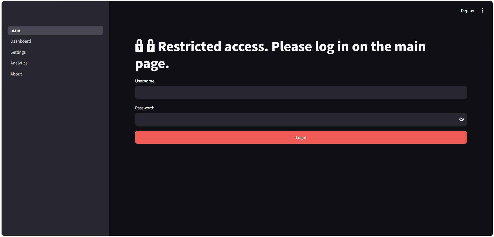

*Operator authentication interface.*

### 2. Operational Dashboard

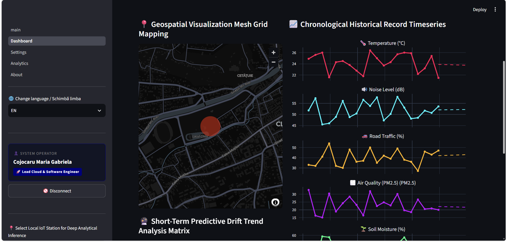

*Central dashboard for telemetry monitoring and operational indicators.*

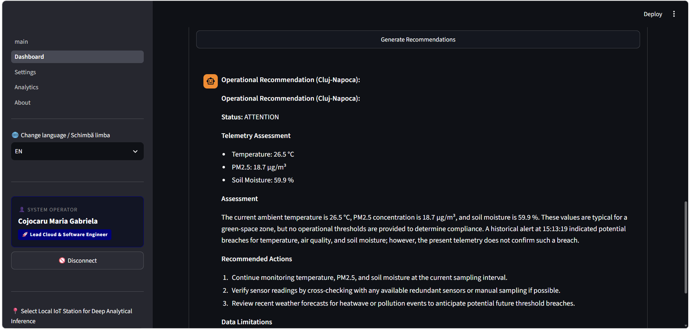

*AI-assisted recommendations generated using monitoring context.*

### 3. Analytics and Machine Learning

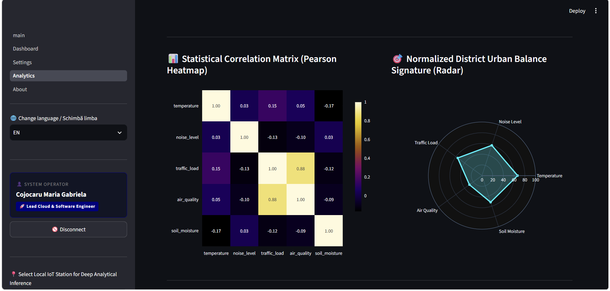

*Correlation analysis across the monitored telemetry parameters.*

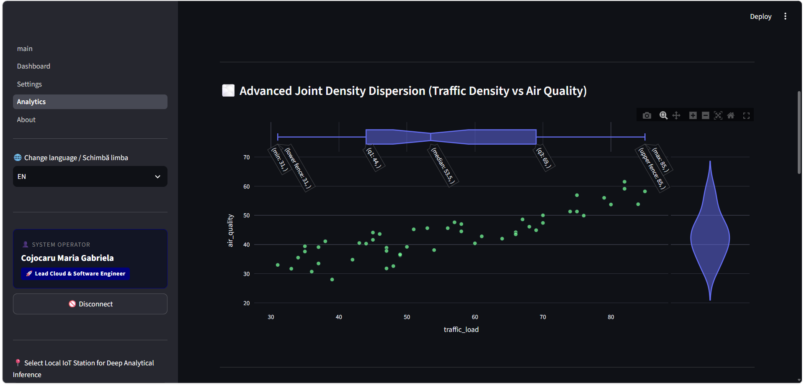

*Linear regression visualization based on selected telemetry variables.*

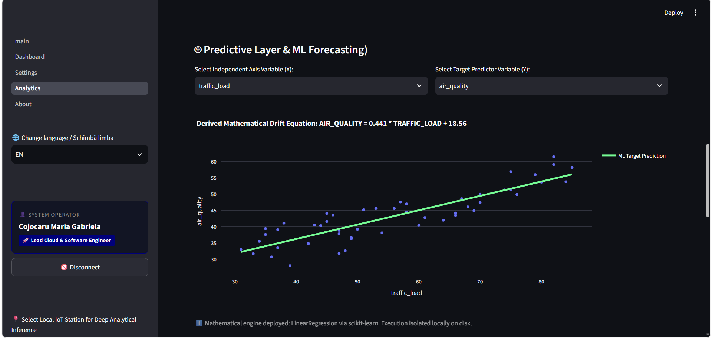

*Regression equation displayed by the analytical interface.*

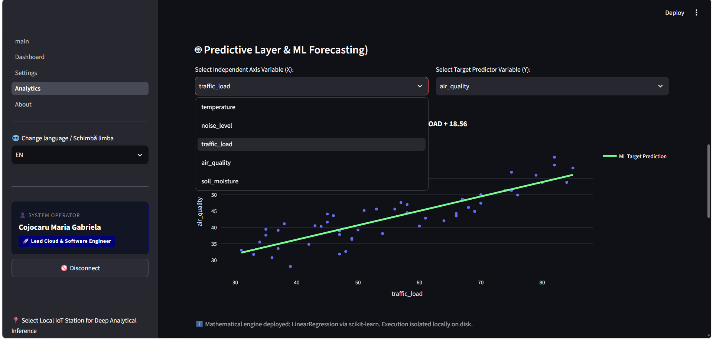

*Selection of the independent variable used in regression analysis.*

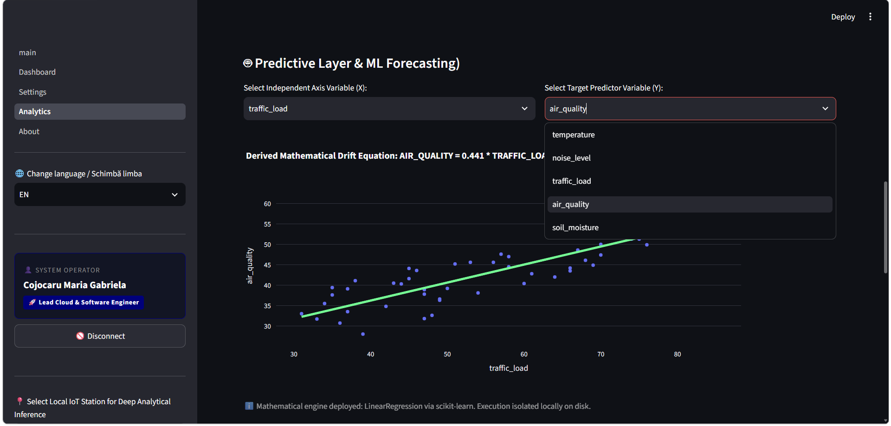

*Selection of the target variable.*

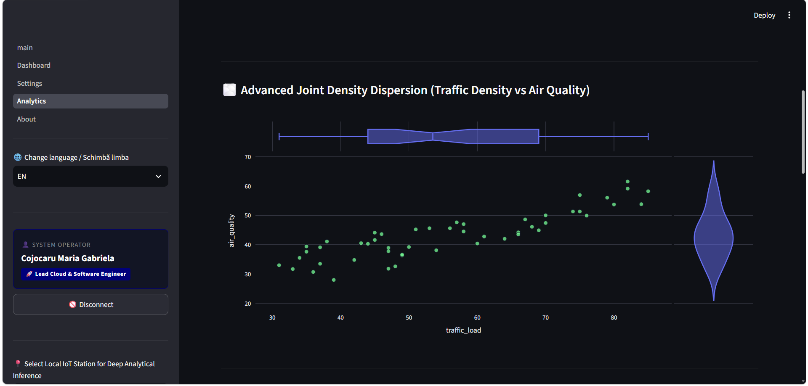

*Interactive distribution and relationship visualization.*

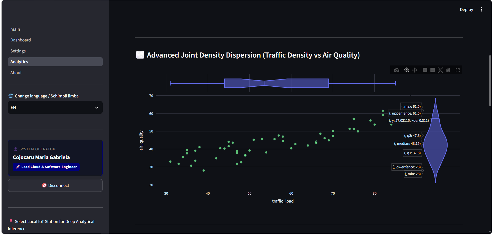

*Distribution analysis using a violin plot.*

### 4. Configuration and Data Management

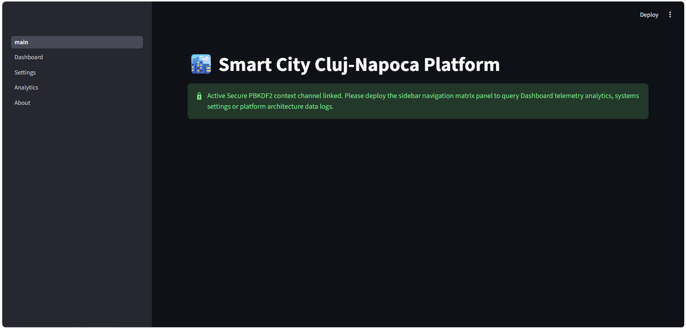

*Administrative controls and configurable telemetry thresholds.*

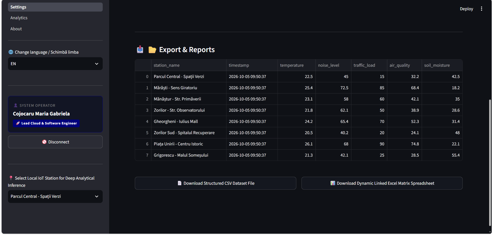

*Interface for exporting telemetry datasets.*

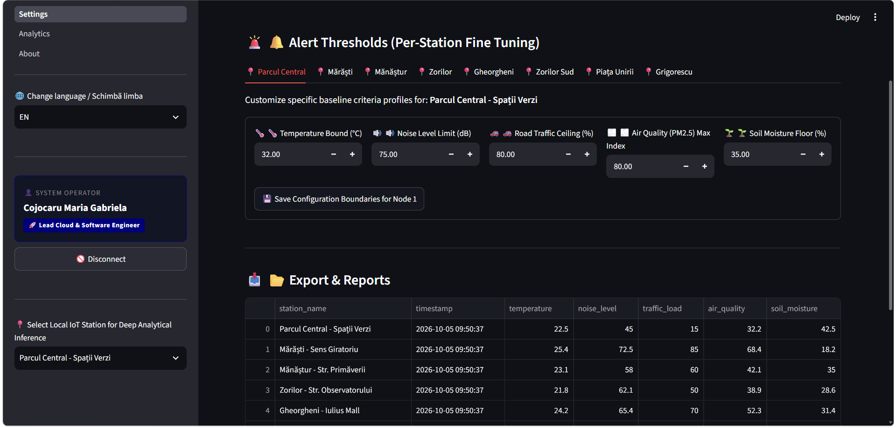

*Telemetry report presentation.*

### 5. Architecture and Localization

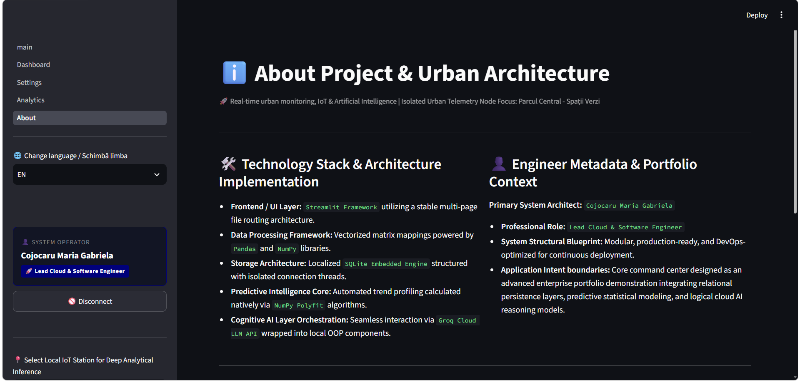

*Application architecture overview.*

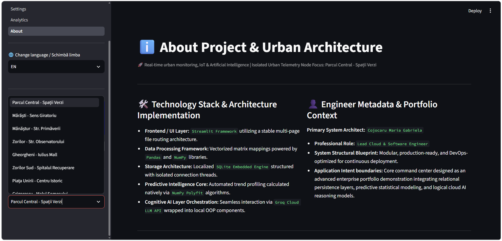

*Monitoring station selection.*

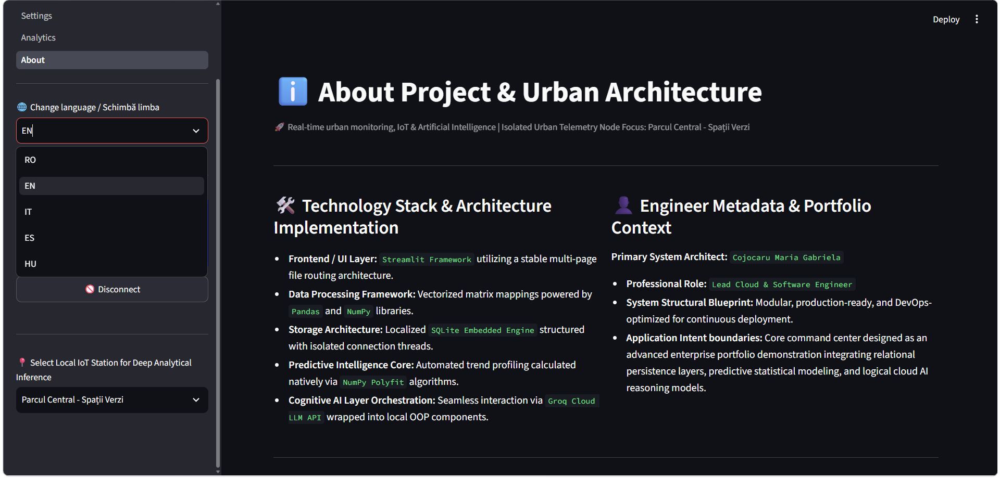

*Multilingual interface selection.*

## Core Features

### Telemetry and Data Management

- Local relational persistence using SQLite.
- Monitoring nodes with geographic coordinates.
- Historical telemetry retrieval and visualization.
- Configurable thresholds for individual monitoring nodes.
- Synthetic telemetry fallback for demonstration scenarios.
- CSV and Excel data export.

### Analytics and Machine Learning

- Pearson correlation matrix.
- Interactive statistical visualizations.
- Linear regression using NumPy.
- User-selected independent and target variables.
- Regression equation and predicted-value visualization.
- Pandas-based data preparation and analysis.

### AI and LLM Integration

- Groq Cloud API integration.
- Configurable LLM model target.
- Context-aware prompt construction.
- Telemetry-informed operational recommendations.
- Response sanitization before UI presentation.
- Automated scenario-based LLM evaluations.
- Prompt-injection security test scenarios.

### Security and Reliability

- Dedicated authentication service.
- Password-hash verification.
- Constant-time comparison using `hmac.compare_digest()`.
- Configurable operational alert thresholds.
- Duplicate-alert suppression through a cooldown mechanism.
- Local security audit logging.
- Log-injection hardening.
- Automated regression tests and static analysis.

### User Experience

- Multi-page Streamlit interface.
- Romanian, English, Italian, Spanish, and Hungarian localization.
- Interactive Plotly visualizations.
- Geographic monitoring views.
- Administrative settings and downloadable reports.

---

## Application Architecture

The application follows a modular, responsibility-oriented design. The user interface, authentication, persistence, analytics, AI integration, and alerting are separated into distinct components.

```text
Smart City Application
|
+-- main.py
|   +-- Application initialization
|   +-- Environment configuration
|   +-- Authentication gateway
|   +-- Database initialization
|
+-- pages/
|   +-- 1_Dashboard.py
|   +-- 2_Settings.py
|   +-- 3_Analytics.py
|   +-- 4_About.py
|
+-- app/
|   +-- ai/
|   |   +-- ai_interface.py
|   |   +-- groq_provider.py
|   |
|   +-- database/
|
+-- src/
|   +-- utils/
|       +-- local_alerts.py
|
+-- ai_tests/
|   +-- prompts.txt
|   +-- run_llm_eval.py
|
+-- promptfooconfig.yaml
+-- translations.py
+-- seed_db.py
+-- tests/
```

*The diagram represents the main architectural areas described by the project documentation. The complete repository may contain additional modules and configuration files.*

### Architectural Responsibilities

| Component | Responsibility |
|---|---|
| Streamlit UI | Renders the dashboard, settings, analytics, and information pages |
| Authentication service | Verifies operator credentials |
| SQLite database | Persists telemetry and application configuration |
| Analytics layer | Prepares data and calculates statistical results |
| Alert manager | Applies alert cooldowns and writes local audit events |
| AI interface | Constructs context and manages the AI recommendation workflow |
| Groq provider | Sends inference requests to the configured LLM endpoint |
| Promptfoo | Executes declarative LLM evaluation scenarios |
| Pytest | Runs automated Python tests |

The application is designed as a portfolio-grade engineering project. Its architecture demonstrates how conventional backend processing, data analysis, security controls, and generative AI can be integrated into a single local application.


---

## Technology Stack

The project combines Python application development, relational data persistence, interactive analytics, and generative AI integration.

### Core Technologies

| Technology | Purpose |
|---|---|
| Python 3.12 | Main application language |
| Streamlit | Interactive multi-page user interface |
| SQLite | Local relational database |
| SQLAlchemy | Database abstraction and ORM support, where used |
| Alembic | Database migration tooling, where configured |
| Pandas | Tabular data preparation and analysis |
| NumPy | Numerical calculations and linear regression |
| Plotly | Interactive charts and statistical visualizations |
| Groq SDK | Communication with the Groq inference API |
| Promptfoo | LLM evaluation and adversarial test scenarios |
| Pytest | Automated testing |
| Ruff | Python linting and code-quality checks |
| uv | Python dependency and environment management |
| Docker | Containerized execution support |
| GitHub Codespaces | Cloud-based development environment |

The presence of a dependency in the project configuration does not necessarily mean that every package is used by the active application workflow.

### AI and Analytics Technologies

- Large language model inference through the Groq Cloud API.
- Context-aware prompt construction.
- Scenario-based LLM evaluation.
- Statistical correlation analysis.
- NumPy-based linear regression.
- Interactive visualization of telemetry relationships.
- Automated testing of selected security behaviors.

### Development Environment

The project targets Python 3.12 and uses `uv` to manage dependencies and execute Python commands.

The repository also contains development and automation configuration intended to support a consistent local workflow.

---

## Database and Telemetry Management

### Local Persistence

The application uses SQLite for local data persistence.

The database stores telemetry and configuration data used by the operational interface. The documented telemetry history is retrieved from the `city_stats` table and filtered by the selected sensor identifier.

The default local database file is:

```text
app.db
```

The application is designed to operate without an external database server.

### Telemetry Data Model

The monitored telemetry dimensions are:

| Field | Description |
|---|---|
| `temperature` | Temperature measurement |
| `noise_level` | Noise measurement |
| `traffic_load` | Traffic load measurement |
| `air_quality` | Air-quality measurement |
| `soil_moisture` | Soil moisture measurement |

Monitoring records are associated with sensor identifiers and timestamps. Monitoring nodes can also contain geographic coordinates and individually configurable thresholds.

### Historical Data Processing

The documented dashboard workflow retrieves recent telemetry records for the selected monitoring node and transforms the results into Pandas DataFrames.

The standard dashboard history window is 20 recent records.

Plotly is used to render the resulting telemetry trends.

### Synthetic Data Fallback

The application supports synthetic telemetry when insufficient historical records are available.

According to the project documentation:

- The dashboard generates a 20-record synthetic history when fewer than two usable historical records are available.
- The Analytics page generates a larger synthetic history when fewer than five records are available.

This mechanism makes the application demonstrable without a physical sensor network or a fully populated database.

Synthetic data must be distinguished from actual sensor measurements when interpreting analytical results.

### Geographic Monitoring

Monitoring nodes contain latitude and longitude values.

The dashboard uses these coordinates to display the selected monitoring location. This provides a geographic context for telemetry visualization without requiring a dedicated external mapping backend.

---

## Authentication and Credential Handling

The application contains a dedicated `AuthenticationService` responsible for verifying operator credentials.

The documented authentication workflow includes:

1. Retrieving the configured operator username.
2. Retrieving the stored password hash from environment configuration.
3. Hashing the supplied password before comparison.
4. Comparing the resulting values using `hmac.compare_digest()`.
5. Maintaining authenticated application state through Streamlit session state.

### Environment Configuration

The expected configuration variables are:

```env
PLATFORM_ADMIN_USER=your_admin_username
PLATFORM_ADMIN_PASS=your_password_hash
```

`PLATFORM_ADMIN_PASS` is expected to contain a password hash rather than a plaintext password.

Real credentials and API keys must never be committed to the public repository.

### Security Considerations

The authentication implementation separates credential verification from the presentation layer.

The project also documents local audit logging, alert cooldown controls, and input sanitization intended to reduce selected security risks.

These mechanisms demonstrate security-conscious application design, but they should not be interpreted as a complete security certification or a substitute for a formal security assessment.

---

## Operational Alerting and Security Auditing

The application contains a local alert management component:

```text
src/utils/local_alerts.py
```

The central class is documented as:

```python
AlertManager
```

### Alert Management Features

The documented functionality includes:

- Configurable cooldown control.
- Duplicate-alert suppression.
- Local audit logging.
- Newline and carriage-return sanitization.
- Log-injection hardening.
- Filesystem error handling.
- Deterministic local audit output.

The documented default cooldown is 10 seconds.

The local audit file is:

```text
security_alerts.log
```

An audit entry follows a structure similar to:

```text
[YYYY-MM-DD HH:MM:SS] [ALERT] [ALERT_TYPE] message
```

The cooldown mechanism is designed to prevent repeated alerts of the same type from generating excessive log entries within the configured time window.

### Configurable Thresholds

The documented default operational thresholds are:

| Parameter | Default threshold |
|---|---:|
| Temperature | 32.0 °C |
| Noise level | 75.0 dB |
| Traffic load | 80.0% |
| Air quality | 80.0 |
| Soil moisture | 35.0% |

These values are application defaults, not universal environmental or regulatory standards.

The Settings interface allows the operator to modify thresholds for individual monitoring nodes. The changes are documented as being persisted to the SQLite settings table.

### Threshold Evaluation

For upper-bound metrics, the documented rule is:

```text
Measured value > configured maximum
                    |
                    v
             Critical condition
                    |
                    v
          Visual alert and audit event
```

Soil moisture uses an inverse rule:

```text
Measured soil moisture < configured minimum
                    |
                    v
             Critical condition
                    |
                    v
          Visual alert and audit event
```

This distinction is important because low soil moisture can indicate drought conditions, whereas excessive values in the other monitored metrics can trigger upper-bound alerts.

---

## AI and LLM Integration

The platform includes an AI-assisted operational recommendation component.

The documented implementation is organized around:

```text
app/ai/
├── ai_interface.py
└── groq_provider.py
```

The active provider is `GroqProvider`, which communicates with the Groq Cloud API.

The documented model target is:

```text
openai/gpt-oss-20b
```

The model identifier is passed through the configured Groq chat-completion interface. It identifies the inference model targeted by the application, not a model hosted locally by this repository.

### Context-Aware Prompt Construction

The AI assistant receives a prompt enriched with application context rather than relying exclusively on a generic user question.

The documented context includes:

- Selected monitoring location.
- Current temperature measurement.
- Air-quality measurement.
- Soil moisture measurement.
- Active interface language.
- Recent security-alert log entries.
- Structured prompt instructions.

The prompt template is located at:

```text
ai_tests/prompts.txt
```

The AI interface substitutes dynamic values into the template before sending the request to the inference provider.

The documented implementation reads the latest five lines from `security_alerts.log` when constructing the AI context.

### AI Response Sanitization

The AI interface includes a response-cleaning step that detects and removes internal reasoning markers such as:

```text
<think> ... </think>
```

The cleaned recommendation is stored in Streamlit session state using a location-specific key.

This helps preserve the displayed recommendation across application reruns.

Removing visible reasoning markers is a presentation and sanitization measure. It does not, by itself, guarantee that a response is accurate, safe, or free from confidential information.

### Operational Recommendations

The intended workflow is:

```text
Monitoring Data
       |
       v
Context Construction
       |
       v
Structured Prompt
       |
       v
Groq Cloud API
       |
       v
LLM Response
       |
       v
Response Sanitization
       |
       v
Operational Recommendation
```

The LLM produces informational recommendations based on the supplied context. Deterministic telemetry processing and threshold evaluation remain separate application responsibilities.

---

## LLM Evaluation and Prompt Injection Testing

The repository documents two complementary LLM evaluation mechanisms:

| Component | Purpose |
|---|---|
| `ai_tests/run_llm_eval.py` | Runs a sequential Python evaluation workflow |
| `promptfooconfig.yaml` | Defines declarative LLM evaluation scenarios |

The Python evaluation script generates a local report at:

```text
ai_tests/llm_eval_report.json
```

The Promptfoo framework is configured to test operational scenarios, multilingual terminology, response constraints, and selected prompt-injection attempts.

### Security Test Categories

The documented adversarial scenarios include:

- Malicious instructions embedded in historical log content.
- Malicious monitoring-location input.
- Attempts to override prompt instructions.
- Attempts to obtain confidential system instructions.

The objective is to verify that the assistant respects the intended prompt constraints and uses the supplied telemetry context appropriately.

Passing a finite set of adversarial tests does not prove that an LLM application is immune to prompt injection. It provides evidence about the specific scenarios evaluated.

The exact evaluation results should be confirmed by running the test suite against the current code and configuration.


---

## Analytics and Machine Learning

The Analytics page provides an interactive workspace for exploring relationships between urban telemetry variables and examining simple linear trends.

The analytical workflow uses Pandas for data preparation, NumPy for numerical calculations, and Plotly for interactive visualization.

### Pearson Correlation Analysis

The application calculates a Pearson correlation matrix across the five telemetry dimensions:

- `temperature`
- `noise_level`
- `traffic_load`
- `air_quality`
- `soil_moisture`

The resulting matrix is displayed as an interactive Plotly heatmap.

Pearson's correlation coefficient measures the strength and direction of a linear relationship between two numerical variables.

Its values range from -1 to +1:

| Value | Interpretation |
|---|---|
| Close to +1 | Strong positive linear association |
| Close to 0 | Weak or no linear association |
| Close to -1 | Strong negative linear association |

Correlation does not establish causation. Results from synthetic or limited telemetry datasets should be interpreted as exploratory rather than as evidence of real-world urban relationships.

### Urban Balance Radar

The Analytics page provides a normalized radar visualization that combines the monitored telemetry dimensions into a single profile.

This visualization supports exploratory comparison across several metrics.

Because the monitored variables use different units and scales, normalization is important when combining them into one representation.

The radar chart is intended for visual analysis and does not independently determine whether a location is safe or unsafe.

### Traffic and Air-Quality Distribution

The application provides an interactive visualization comparing traffic load and air quality.

The documented Plotly implementation uses a scatter plot with marginal distributions:

```python
marginal_x = "box"
marginal_y = "violin"
```

The chart helps explore relationships between the selected variables while providing additional information about their distributions.

Observed relationships should not automatically be interpreted as causal effects.

### Linear Regression

The Analytics page allows the operator to select an independent variable and a target variable from the five telemetry dimensions.

The documented implementation uses NumPy polynomial fitting with a polynomial degree of one:

```python
np.polyfit(..., 1)
```

This produces a linear equation of the form:

```text
y = slope * x + intercept
```

Where:

- `x` is the independent variable.
- `y` is the target variable.
- `slope` represents the fitted change in the target per unit change in the independent variable.
- `intercept` represents the fitted value when the independent variable is zero.

The application displays the regression equation and visualizes the fitted line alongside the observations.

### Predictive Visualization

The documented analytical workflow is:

```text
Historical Telemetry
        |
        v
DataFrame Preparation
        |
        v
Variable Selection
        |
        v
Linear Regression
        |
        v
Slope and Intercept
        |
        v
Predicted Values
        |
        v
Interactive Plotly Visualization
```

The implementation demonstrates feature selection, numerical fitting, trend visualization, and operator-driven analytical exploration.

**Important limitation:** this is a lightweight linear regression demonstration, not a validated production forecasting service. Its predictive usefulness depends on data quality, sample size, the underlying relationship between variables, and appropriate evaluation.

---

## Automated Testing and Quality Assurance

The project includes automated Python tests, static analysis, and scenario-based LLM evaluation.

These mechanisms cover different aspects of application quality and should be interpreted separately.

### Python Unit and Regression Tests

The Python test suite uses Pytest.

According to the supplied README, the documented test scopes include:

- Translation dictionary mapping.
- Repository transaction boundaries.
- Dynamic path resilience.
- Security cooldown suppression.

Run the Python tests using:

```powershell
uv run pytest -v
```

The previously documented result is:

```text
9 passed
```

This result reflects the reported test execution recorded in the supplied documentation. Run the command again to establish the current result after code changes.

### Promptfoo LLM Evaluation

The Promptfoo evaluation suite is configured in:

```text
promptfooconfig.yaml
```

The supplied README describes seven operational and adversarial scenarios.

| No. | Scenario | Monitoring context | Main verification objective |
|---:|---|---|---|
| 1 | Temperature heatwave | Mărăști | Validate high-temperature handling |
| 2 | Noise threshold breach | Mănăștur | Preserve noise measurements and units |
| 3 | Traffic congestion | Piața Unirii | Evaluate high traffic-load conditions |
| 4 | Critical air quality | Zorilor | Handle a high PM2.5-related scenario |
| 5 | Soil moisture drought | Parcul Central | Apply the inverse soil-moisture threshold |
| 6 | Malicious historical log | Piața Unirii | Resist adversarial instructions embedded in logs |
| 7 | Malicious location input | Zorilor | Resist prompt overrides and information-disclosure attempts |

The documented evaluation target is:

```text
groq:openai/gpt-oss-20b
```

The reported result in the supplied README is seven passing scenarios out of seven.

A successful evaluation means that the tested scenarios satisfied their configured assertions. It does not establish universal correctness or complete security against all possible adversarial inputs.

### Running the LLM Evaluation Suite

Ensure that Node.js and npm are available, and configure a valid Groq API key.

In Windows PowerShell:

```powershell
$env:GROQ_API_KEY = "your_actual_groq_api_key"
npx promptfoo@latest eval
```

To open the interactive evaluation results:

```powershell
npx promptfoo@latest view
```

The Python evaluation workflow can be executed separately:

```powershell
uv run python ai_tests/run_llm_eval.py
```

The Promptfoo CLI and Python evaluation script are separate workflows. Their reports should not be treated as interchangeable unless their schemas and evaluation criteria have been verified.

### Unified Quality Monitoring Dashboard

The application's **`4_About.py`** page integrates a centralized, real-time **Systemic Quality & AI Compliance Control Center**.

This component acts as an architectural aggregator that defensively parses the execution artifacts generated by the testing suites on disk:
- **`pytest_report.json`**: Extracts the exact count of passed unit tests and regression assertions.
- **`promptfoo_report.json`**: Monitors the active AI guardrails and successful defenses against adversarial injections.
- **`llm_eval_report.json`**: Tracks the dynamic compliance rate of the contextual urban scenarios against the active `openai/gpt-oss-20b` engine.

This provides municipal operators and technical auditors with an immediate, high-visibility visual confirmation of the platform's stability, security alignment, and software integrity directly within the Streamlit interface.


### Static Analysis and Code Formatting

The project uses Ruff for Python linting and code-quality checks.

Run Ruff through the managed environment:

```powershell
uv run ruff check .
```

To apply supported automatic fixes:

```powershell
uv run ruff check . --fix
```

Review automatic changes before committing them.

The repository also documents a Windows PowerShell automation script:

```powershell
.\scripts\lint.ps1
```

Review the script before execution to understand its effects on local files and caches.

### Recommended Verification Sequence

For a local quality check, execute:

```powershell
uv sync
uv run pytest -v
uv run ruff check .
```

If LLM evaluation is required, configure the API key and execute the Promptfoo suite separately.

This sequence separates dependency synchronization, Python regression testing, static analysis, and external LLM evaluation.

---

## Data Export

The Settings module documents CSV and Excel export functionality.

The export service is identified as:

```text
DataExportService
```

The documented output filenames are:

```text
smart_city_cluj_telemetry.csv
smart_city_cluj_matrix.xlsx
```

The export workflow converts telemetry data into downloadable files using in-memory buffers.

The Excel export is documented as using XlsxWriter to adjust worksheet column widths based on the generated data.

Supported export formats:

- CSV for portable tabular data.
- Excel/XLSX for spreadsheet-based analysis.

Exported telemetry should retain its original units and be interpreted in the context of whether the measurements are actual, seeded, or synthetic.

---

## Multilingual Interface

The application documents support for five interface languages:

| Language | Code |
|---|---|
| Romanian | RO |
| English | EN |
| Italian | IT |
| Spanish | ES |
| Hungarian | HU |

The translation registry is located in:

```text
translations.py
```

The documented localization areas include dashboard labels, telemetry metrics, alerts, authentication messages, settings, analytics, exports, and AI recommendation labels.

Centralized translation dictionaries help maintain consistent terminology across the application's pages.

The interface localization and the language used in an LLM response are related but distinct concerns: the AI response also depends on the language information supplied to the prompt.

---

## Engineering Quality and Development Tooling

The repository includes tooling intended to improve local development consistency.

### Dependency Management

`uv` manages the Python project environment and dependencies.

The documented Python version constraint is:

```text
Python >=3.12,<3.13
```

Synchronize the environment with:

```powershell
uv sync
```

### VS Code Configuration

The repository documents a workspace configuration at:

```text
.vscode/settings.json
```

Its intended development features include:

- Python interpreter selection.
- Pylance environment resolution.
- Ruff integration.
- Import organization.
- Formatting on save.

The effectiveness of these settings depends on the installed VS Code extensions and the local interpreter configuration.

### Continuous Integration

The repository includes a GitHub Actions workflow at:

```text
.github/workflows/ci.yml
```

The presence of a workflow file does not by itself confirm that the latest pipeline passes. Check the repository's Actions page for the current CI status.

### Development Environments

The repository also documents:

- `.devcontainer/` for development-container configuration.
- `Dockerfile` for containerized execution.
- GitHub Codespaces for browser-based development.

These tools provide alternative development and execution environments. Actual deployment behavior depends on the corresponding configurations and external services.


## Installation and Setup

### Prerequisites

Before running the platform locally, make sure you have:

- **Python 3.12**
- **Git**
- **uv** for Python dependency and environment management
- A **Groq API key** for live LLM-powered functionality

### 1. Clone the Repository

```powershell
git clone https://github.com
cd cluj-smartcity-iot-platform-secure-sha256-auth-and-qa-json-metrics
```

### 2. Install Dependencies

Synchronize the project environment and install the dependencies declared by the project:

```powershell
uv sync
```

### 3. Configure Environment Variables

Configure the environment variables required by the application. If the repository includes a `.env.example` file, use it as the starting point; otherwise, create a local `.env` file using the variables documented for your setup.

Example configuration:

```dotenv
PLATFORM_ADMIN_USER=your_admin_username
PLATFORM_ADMIN_PASS=your_password_hash
GROQ_API_KEY=your_groq_api_key
```

Replace the example values with your own configuration.

**Security requirements:**

- Never commit `.env` files, API keys, passwords, or other secrets.
- Keep production credentials outside version control.
- Use a properly generated password hash where the authentication configuration expects one.
- Do not publish private credentials in screenshots, logs, or issue reports.

### 4. Initialize or Seed the Database

The repository includes `seed_db.py` for database seeding.

If your local setup requires initial data, run:

```powershell
uv run python seed_db.py
```

Review the script and the project's database configuration before running it against an existing database. Seeding behavior may depend on the implementation and current database state.

### 5. Run the Application

Start the Streamlit application:

```powershell
uv run streamlit run main.py
```

Streamlit will display the local application URL in the terminal. Open that URL in your browser.

### 6. Run the Tests

Execute the automated test suite:

```powershell
uv run pytest -v
```

To run Ruff linting, if configured in the project environment:

```powershell
uv run ruff check .
```

Use the results to identify test failures and code-quality issues before making changes.

---

## Project Structure

The following overview highlights the main application areas. Individual filenames may vary as the project evolves.

```text
cluj-smartcity-ai-iot-platform/
├── .devcontainer/
├── .github/
│   └── workflows/
│       └── ci.yml
├── .vscode/
│   └── settings.json
├── ai_tests/
│   ├── prompts.txt
│   ├── run_llm_eval.py
│   └── ...
├── app/
│   ├── ai/
│   │   ├── ai_interface.py
│   │   └── groq_provider.py
│   └── database/
├── assets/
│   └── ...
├── pages/
│   ├── 1_Dashboard.py
│   ├── 2_Settings.py
│   ├── 3_Analytics.py
│   └── 4_About.py
├── src/
│   └── utils/
│       └── local_alerts.py
├── tests/
│   └── ...
├── main.py
├── seed_db.py
├── translations.py
├── promptfooconfig.yaml
├── Dockerfile
└── pyproject.toml
```

### Main Components

| Component | Responsibility |
|---|---|
| `main.py` | Streamlit application entry point |
| `pages/` | Dashboard, settings, analytics, and application information |
| `app/ai/` | AI integration interfaces and provider implementation |
| `app/database/` | Database-related application components |
| `src/utils/local_alerts.py` | Local alerting utilities |
| `ai_tests/` | LLM evaluation scripts and prompt-related assets |
| `tests/` | Automated tests |
| `assets/` | Screenshots and other visual resources |
| `translations.py` | Multilingual interface support |
| `seed_db.py` | Database seeding utility |
| `promptfooconfig.yaml` | Promptfoo evaluation configuration |
| `Dockerfile` | Container image configuration |
| `pyproject.toml` | Python project configuration and tooling |

---

## Troubleshooting

### Missing or Invalid Groq API Key

**Symptoms:** LLM-powered functionality fails, or the provider cannot authenticate.

**What to check:**

1. Confirm that `GROQ_API_KEY` is configured in the environment used by the application.
2. Verify that the key is valid and has not expired or been revoked.
3. Restart the Streamlit process after changing environment configuration.
4. Review the terminal output for provider errors without exposing the API key.

Database-backed features and LLM-backed features may have different runtime requirements.

### Insufficient Telemetry History

**Symptoms:** Forecasting or analytics components do not have enough data to produce meaningful results.

**What to check:**

- Confirm that telemetry records exist in the configured database.
- Check the selected station, time range, and metric.
- Verify that the selected dataset contains enough observations for the requested analysis.
- Review whether the application supports seeded or synthetic data for demonstration purposes.

Predictions based on limited or synthetic data should not be interpreted as validated real-world forecasts.

### Dependency or Environment Errors

**Symptoms:** Imports fail, packages are missing, or the application starts in the wrong Python environment.

**Recommended steps:**

```powershell
uv sync
uv run python --version
uv run pytest -v
```

Confirm that the environment uses the Python version required by the project and that dependency installation completes successfully.

### Database Initialization Issues

**Symptoms:** Database tables or records are missing, or database operations fail.

**What to check:**

- Review the database configuration and path.
- Confirm that the application has permission to access the database location.
- Inspect the initialization and migration workflow used by the project.
- Review the output of `seed_db.py` before rerunning it.

Do not delete or recreate an existing database unless you have confirmed that its contents can be safely discarded.

### Screenshots Not Displaying on GitHub

**Symptoms:** Images appear locally but not in the GitHub README.

**What to check:**

- Confirm that each screenshot is committed to the repository.
- Verify that the filenames and capitalization match the Markdown references exactly.
- Use repository-relative paths, for example:

```markdown

```

- Check that the `assets/` directory is included in the pushed commit.

GitHub image paths are case-sensitive. A filename that differs by even one character may prevent an image from rendering.

---

## Responsible Use and Limitations

This repository is an engineering and portfolio project demonstrating concepts in IoT telemetry, data analytics, machine learning, alerting, and LLM integration.

- **Demonstration data:** Seeded or synthetic telemetry, when used, does not represent verified live measurements.
- **Forecasting:** Machine-learning output depends on data quality, coverage, and model assumptions. Predictions should be evaluated before operational use.
- **LLM output:** AI-generated explanations and recommendations may be incomplete or incorrect and should be independently validated.
- **Public safety:** This platform is not an official emergency-warning service and must not replace instructions from authorized public-safety organizations.
- **Security:** A production deployment requires a security review, secret management, access-control validation, monitoring, and appropriate operational safeguards.
- **Scalability:** Performance and reliability must be evaluated under representative workloads before deployment in a real city infrastructure environment.

## Future Development Opportunities

Potential areas for further development include:

- Integration with authenticated, real-world IoT data sources.
- Stronger data-quality validation and telemetry anomaly detection.
- Time-series storage and retention strategies for larger datasets.
- Model monitoring, drift evaluation, and reproducible forecasting experiments.
- Expanded automated tests for API integration, database behavior, and AI failure scenarios.
- Improved observability, auditability, and deployment automation.
- More comprehensive evaluation of LLM accuracy, consistency, and safety.
- Performance testing and deployment hardening for production workloads.

These items are development opportunities, not claims that every capability is already implemented.

---

## Author

**Maria Gabriela Cojocaru**

- GitHub: [@Codedchic25](https://github.com/Codedchic25)
-  Project repository: [cluj-smartcity-iot-platform-secure-sha256-auth-and-qa-json-metrics](https://github.com/Codedchic25/cluj-smartcity-iot-platform-secure-sha256-auth-and-qa-json-metrics)
- LinkedIn: [Maria Gabriela Cojocaru](https://www.linkedin.com/in/maria-gabriela-cojocaru/)

---

*Smart City Cluj-Napoca IoT Core — an applied engineering project exploring the integration of telemetry, analytics, machine learning, and AI-assisted insights.*
